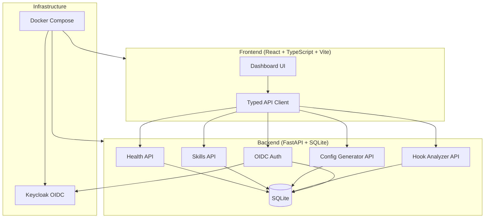

# Beacon Observatory — Alan Vo

> Work in progress. This checkpoint may be incomplete or fail tests. See PLAN.md and STATUS.md before use.


**Beacon Observatory** — AI/ML developer tools for pstack agent workflows  
Alan Vo | AI & Machine Learning

---

## Overview

Beacon Observatory provides a unified platform for managing and analyzing pstack-style agent workflows across multiple AI coding assistants: **Claude Code, Codex, Copilot, Pi, OpenCode, Gemini, and Prime Agent**.

The product addresses a core problem identified in [pstack-claude#264](https://github.com/michael-denyer/pstack-claude/issues/264): **hook text rarely reaches Claude subagents, and the router is opened in only ~19% of main sessions**. Beacon Observatory delivers:

1. **Skill/Playbook Registry** — Persistent storage and CRUD API for pstack skills, playbooks, and principles
2. **Multi-Agent Config Generator** — Generate agent-specific configurations (hooks, skills, playbooks) for all supported agents
3. **Hook Effectiveness Analyzer** — Ingest session logs and compute hook reach/follow-through rates by agent type and session type (main vs subagent), with reproducible baselines
4. **OIDC Authentication** — Secure Keycloak-based auth with roles (viewer/operator/admin) and local demo mode

---

## Architecture



---

## Quick Start

### Prerequisites

- Docker & Docker Compose (recommended)
- OR: Python 3.12+, Node 24+

### Using Docker Compose (Recommended)

```bash
# Clone and navigate
cd beacon-observatory-alan-vo

# Start all services
docker compose up --build

# Frontend: http://localhost:8080
# Backend API: http://localhost:8000
# API Docs: http://localhost:8000/docs
```

### Local Development

**Backend:**

```bash
cd backend
python -m venv .venv
.venv/bin/pip install -r requirements.txt
cp ../.env.example .env
.venv/bin/python -m uvicorn app.main:app --reload --host 127.0.0.1 --port 8000
```

**Frontend:**

```bash
cd frontend
npm install
npm run dev
# Serves at http://localhost:5173 with API proxy to backend
```

---

## Running Tests

### Backend Tests

```bash
cd backend
.venv/bin/python -m pytest tests/ -v
```

### Frontend Tests

```bash
cd frontend
npm install
npm run test
```

### Type Checking

```bash
cd frontend
npm run build  # Runs tsc then vite build
```

---

## API Reference

### Health Endpoints

| Method | Endpoint | Description |
|--------|----------|-------------|
| GET | `/api/healthz` | Basic health check for load balancers |
| GET | `/api/health` | Detailed health with system checks |

**Response (Healthy):**
```json
{
  "status": "healthy",
  "version": "1.0.0",
  "environment": "development",
  "timestamp": "2026-10-13T10:30:00Z",
  "database": "connected",
  "uptime_seconds": 123.45,
  "checks": {
    "database": true,
    "config_loaded": true
  }
}
```

### Skills Endpoints (Planned)

| Method | Endpoint | Description |
|--------|----------|-------------|
| POST | `/api/skills` | Create a new skill |
| GET | `/api/skills` | List skills (paginated, filterable) |
| GET | `/api/skills/{id}` | Get skill detail |
| PUT | `/api/skills/{id}` | Update skill |
| DELETE | `/api/skills/{id}` | Delete skill |

### Config Generator Endpoints (Planned)

| Method | Endpoint | Description |
|--------|----------|-------------|
| POST | `/api/generate/config` | Generate agent configuration |
| GET | `/api/generate/templates` | List available templates |

### Hook Analyzer Endpoints (Planned)

| Method | Endpoint | Description |
|--------|----------|-------------|
| POST | `/api/analyze/import` | Import session logs |
| GET | `/api/analyze/report` | Get effectiveness report |
| GET | `/api/analyze/export` | Export analysis (JSON/CSV) |

---

## Configuration

### Environment Variables

| Variable | Default | Description |
|----------|---------|-------------|
| `APP_NAME` | `beacon-observatory` | Application name |
| `APP_VERSION` | `1.0.0` | Application version |
| `ENVIRONMENT` | `development` | `development\|staging\|production` |
| `DEBUG` | `true` | Enable debug mode |
| `HOST` | `127.0.0.1` | Server bind address |
| `PORT` | `8000` | Server port |
| `DATABASE_URL` | `sqlite+aiosqlite:///./data/beacon.db` | SQLAlchemy database URL |
| `CORS_ORIGINS` | `["http://localhost:5173",...]` | Allowed CORS origins (JSON array) |
| `OIDC_ENABLED` | `false` | Enable OIDC authentication |
| `OIDC_ISSUER_URL` | — | Keycloak issuer URL |
| `OIDC_CLIENT_ID` | — | OIDC client ID |
| `OIDC_CLIENT_SECRET` | — | OIDC client secret |
| `LLM_API_KEY` | — | LLM provider API key (server-only) |
| `LLM_PROVIDER` | — | `openai\|anthropic\|gemini\|ollama` |
| `LLM_MODEL` | — | Model identifier |
| `LLM_BASE_URL` | — | Custom base URL for OpenAI-compatible |
| `DEMO_MODE` | `true` | Enable local demo mode (localhost only) |
| `DEMO_MODE_BIND_ADDRESS` | `127.0.0.1` | Demo mode bind address |

### LLM Provider Configuration

Beacon Observatory supports multiple LLM providers through a unified interface:

| Provider | Base URL | Models |
|----------|----------|--------|
| OpenAI | `https://api.openai.com/v1` | gpt-4o, gpt-4o-mini, etc. |
| Anthropic | `https://api.anthropic.com` | claude-3-5-sonnet, etc. |
| Gemini | `https://generativelanguage.googleapis.com` | gemini-1.5-pro, etc. |
| Ollama | `http://localhost:11434` | Local models |
| OpenRouter | `https://openrouter.ai/api/v1` | Various |
| LiteLLM | Custom | Various |

**Security:** API keys are **server-side only**. Never expose keys to the frontend. Configure via environment variables only.

---

## AI/ML Evaluation

### Hook Effectiveness Baseline (Issue #264)

**Problem:** Claude Code main sessions open the pstack router in only ~19% of sessions; subagents in ~0.3%.

**Measurement Method:**
1. Ingest session transcripts from local logs
2. Identify sessions where hook text was injected
3. Count router/playbook/principle opens per 100 prompts
4. Segment by: agent type (Claude/Codex/Copilot), session type (main/subagent)

**Reproducible Command:**
```bash
# After implementing hook analyzer (planned)
curl -X POST http://localhost:8000/api/analyze/import \
  -H "Content-Type: application/json" \
  -d '{"logs_path": "./session-logs", "agent": "claude"}'

curl http://localhost:8000/api/analyze/report
```

**Expected Baseline (from pstack-claude#264):**

| Agent | Session Type | Hook Reach | Router Opens/100 | Playbook Opens/100 | Principle Opens/100 |
|-------|-------------|------------|------------------|-------------------|---------------------|
| Claude | Main | ~100% | 19 | 3 | 3 |
| Claude | Subagent (plain) | ~0.3% | 4 | 1 | 2 |
| Claude | Subagent (poteto-agent) | ~100% | 76 | 5 | 14 |
| Codex | Headless | ~100% | 19-25 | 14-18 | 9-12 |
| Codex | Subagent | ~100% | — | 39 | 71 |

**Failure Cases:**
- Hook text not injected due to agent plugin manifest conflicts (Codex, Issue #265)
- Subagent hook propagation not supported by Claude Code
- Router requires second file read — inlining index may improve follow-through

---

## Security

### Authentication

- **Production:** OIDC via Keycloak with SAML identity broker support
- **Development:** Demo mode binds to `127.0.0.1` only; refuses to start in production
- **Token Handling:** Bearer tokens in memory only; no localStorage persistence
- **Session Management:** HttpOnly SameSite cookies with CSRF protection (backend sessions) OR SPA PKCE flow

### Security Limitations

- Demo mode is **not secure** for production use
- SQLite is single-file; not suitable for high-concurrency production
- No rate limiting implemented yet
- Audit logging minimal in current version

---

## Deployment

### Production Checklist

- [ ] Set `ENVIRONMENT=production`
- [ ] Set `DEBUG=false`
- [ ] Configure `OIDC_ENABLED=true` with valid Keycloak realm
- [ ] Use PostgreSQL instead of SQLite (`DATABASE_URL=postgresql+asyncpg://...`)
- [ ] Configure TLS reverse proxy (nginx/Traefik/Caddy)
- [ ] Set secure `LLM_API_KEY` for AI features
- [ ] Disable `DEMO_MODE`
- [ ] Configure backup/restore for database volume

### TLS Reverse Proxy Requirements

```
Frontend (8080) <-- HTTPS :443 --> Backend (8000) <-- Keycloak (8443)
```

- Terminate TLS at reverse proxy
- Forward `X-Forwarded-Proto`, `X-Forwarded-For` headers
- WebSocket support for future real-time features
- Health check endpoints accessible for orchestration

---

## Project Structure

```
beacon-observatory-alan-vo/
├── backend/
│   ├── app/
│   │   ├── api/           # API route handlers
│   │   ├── core/          # Config, database, security
│   │   ├── models/        # SQLAlchemy models
│   │   └── services/      # Business logic
│   ├── tests/             # Pytest tests
│   ├── requirements.txt
│   └── Dockerfile
├── frontend/
│   ├── src/
│   │   ├── api/           # Typed API client
│   │   ├── components/    # React components
│   │   ├── hooks/         # Custom React hooks
│   │   └── types/         # TypeScript types
│   ├── tests/             # Vitest tests
│   ├── package.json
│   ├── vite.config.ts
│   └── Dockerfile
├── docker-compose.yaml
├── .env.example
├── feature-plan.json
├── PLAN.md
├── CHANGELOG.md
└── README.md
```

---

## Changelog

See [CHANGELOG.md](CHANGELOG.md) for detailed changes.

### v1.0.0 (2026-10-13)
- Initial release: FastAPI/React skeleton with health check workflow
- Docker Compose orchestration
- Basic health monitoring UI
- Test suite (backend + frontend)

---

## License

MIT License — Copyright (c) 2026 Alan Vo <alanvo@gmail.com>

---

## References

- [pstack-claude](https://github.com/michael-denyer/pstack-claude) — Upstream reference implementation
- [Issue #264](https://github.com/michael-denyer/pstack-claude/issues/264) — Hook reach/follow-through analysis
- [Issue #265](https://github.com/michael-denyer/pstack-claude/issues/265) — Codex plugin manifest conflict
- [Issue #105](https://github.com/michael-denyer/pstack-claude/issues/105) — Grok CLI orchestration
- [Issue #261](https://github.com/michael-denyer/pstack-claude/issues/261) — Metric verification & blast-radius